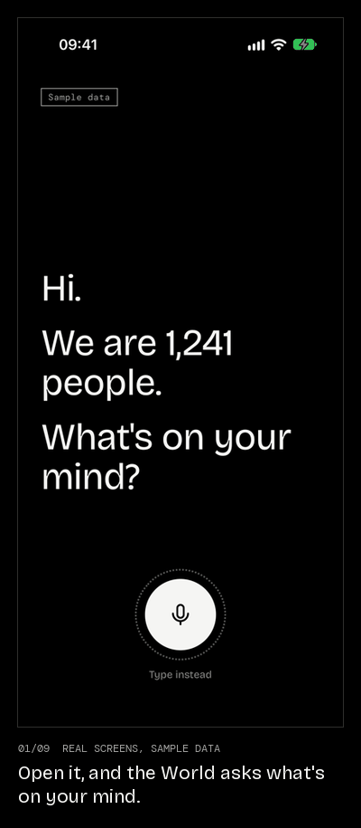

# Demos

<p align="center"></p>

<p align="center">Real screens from the iPhone simulator. The numbers are sample data.<br><b><a href="https://abozaralizadeh.github.io/Demos/">Project page</a></b></p>

Demos is a voice app where you talk to everyone at once.

You tap the mic and say what's on your mind. "The World" answers. It's an AI with no name and no opinions of its own. It speaks as "we", and it can only say what real people said or what labelled data shows. When it doesn't know, it says so.

There's no voting. The World works out where you stand from how you talk, and checks that with you before it counts. Then it brings you the strongest argument from the people who disagree. When an idea wins support across groups and keeps it, it becomes an Agreement: a live card you can share.

The name is Greek for "the people".

## Status

Early, and there's no hosted version to try. The backend and the phone app work end to end on a laptop, on sample data:

- The talk engine, its honesty checks, the worker and the API, with tests against a real Postgres
- An Expo app for iPhone and Android: the full talk, the Map, You, Agreement cards, settings, error screens, the safety card and local notifications

What's still stand-in: the World uses fixed templates unless you give it a model key, sign-in is a labelled dev stub, every number is sample data, and facts about Milan are placeholders. Voice hasn't been tested on a real phone yet. The [roadmap](docs/ROADMAP.md) has the full list.

## Quick start

You need Docker, [uv](https://docs.astral.sh/uv/) and Python 3.12 or 3.13. For the app you also need Node 20 or newer and Xcode (iPhone) or Android Studio.

```bash
git clone https://github.com/abozaralizadeh/Demos.git demos && cd demos
cp .env.example .env
docker compose up -d
```

Postgres runs on port 5433. Then start the backend. The identity service and the API each need their own terminal:

```bash
cd backend
uv sync
uv run python -m demos.seed
uv run uvicorn demos.identity_service:app --port 8001
```

```bash
cd backend
uv run uvicorn demos.api:app --port 8000
```

The worker is optional for a local try: `uv run python -m demos.worker`.

Then the app:

```bash
cd app
npm install
npx expo run:ios
```

The first native build takes a while. Use `npx expo run:android` for Android. On macOS, if CocoaPods complains about encoding, run it with `LANG=en_US.UTF-8`. It's a dev build, not Expo Go, because speech recognition is a native module. After the first build, `npx expo start` is enough.

The app talks to `http://127.0.0.1:8000` and `http://127.0.0.1:8001`. To point it somewhere else, set `EXPO_PUBLIC_API_URL` and `EXPO_PUBLIC_IDENTITY_URL`.

`DEMOS_PREVIEW_FEATURES=1` on the API turns on features that are built but held back: Italy and World on the Map, the anonymity switch and petitions.

## Tests

With the Docker database up:

```bash
cd backend
uv run --group dev pytest
```

Tests use their own databases, so they never touch your dev data. For the app, `cd app && npx tsc --noEmit` checks the types.

## Running it on a server

`setup_service.sh` sets up a fresh Linux machine on first run, and updates and restarts everything when you run it again. It installs Docker and uv, creates `.env` with random secrets, and runs three systemd services: `demos-api`, `demos-identity` and `demos-worker`. Logs go to journald and to size-limited files in `logs/`.

It's meant for a test box. Don't run it with real people's data until the dev sign-in stub is replaced and sample mode is off.

## How it's built

| Doc | What's in it |
| --- | --- |
| [docs/CONCEPT.md](docs/CONCEPT.md) | What Demos is meant to feel like and how it behaves |
| [docs/DESIGN.md](docs/DESIGN.md) | Architecture, stack, data model, key decisions and why |
| [docs/LOGICAL-FLOW.md](docs/LOGICAL-FLOW.md) | The main flows, step by step, with diagrams |
| [docs/ROADMAP.md](docs/ROADMAP.md) | What's built and what's next |

| Folder | What's in it |
| --- | --- |
| `backend/` | FastAPI, Postgres and the talk engine |
| `app/` | The Expo phone app. Screens are in `app/src/`, all UI text in `app/src/copy.ts` |
| `site/` | The project page |

## Contributing

Issues and pull requests are welcome. Read [CONTRIBUTING.md](CONTRIBUTING.md) first: the World never invents people, opinions or numbers, and contributions are only accepted under the terms there.

## License

Demos is source available, free for non-commercial use ([PolyForm Noncommercial 1.0.0](LICENSE)). You can use it, study it, change it and share it for anything that isn't commercial. The docs and images are under [CC BY-NC 4.0](LICENSE-DOCS.md).

Commercial use needs written permission. To ask, [open an issue](https://github.com/abozaralizadeh/Demos/issues).

Third-party code and fonts keep their own licenses. See [THIRD_PARTY_NOTICES.md](THIRD_PARTY_NOTICES.md).
