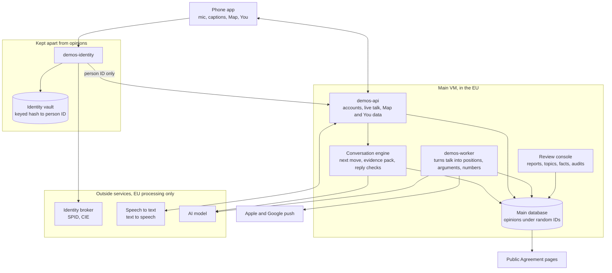
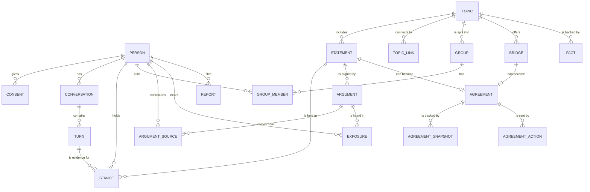

# Demos: technical design

How Demos should be built, and why. Product behaviour lives in the [concept](CONCEPT.md) and this doc doesn't repeat it. What's built so far is in the [roadmap](ROADMAP.md).

**Decided** means it comes from the concept or the finished design. **Proposed** means it's a recommendation that still needs a yes.

## The design

The visual design started as 17 phone screens in a separate design file that isn't public. The app now follows it, so the screens in the app are the reference.

The main design rules:

- The interface is black and white, because the World has no side. Colour only ever measures something: red for divided, grey for mixed, green for agreement.
- Round marks mean people and square marks mean data.
- A topic is two circles. The distance between them is the gap, and the overlap is the common ground.
- The whole screen flips to white when the World speaks as the people who disagree with you.
- The mic is the Talk tab, between Map and You.
- Conversation is big captions, with no chat bubbles. The five modes are never labelled.

## The idea that shapes everything

Most chat apps let the model talk freely. Demos can't, because its honesty rules are the product.

So the model never decides what's true or what the numbers are. Code picks the facts, the model puts them into words, and code checks those words before anyone hears them. If a sentence can't be traced back to real people or labelled data, it doesn't get said.

The rest of this design follows from that.

## Architecture



| Part | Job |
| --- | --- |
| Phone app | Records the mic, shows captions, plays the World's voice, draws the Map and You |
| demos-api | Sign-in sessions, the live WebSocket for a talk, read APIs for Map and You |
| Conversation engine | Runs inside demos-api at first. Picks the next move, builds the evidence pack, gets a reply written, checks it |
| demos-worker | Background jobs: pulls claims from talks, merges arguments, updates stances and numbers, checks Agreement rules, prepares what the World says first |
| Review console | A small web tool for people: reports, new topics, arguments before first use, facts, audit samples |
| demos-identity | Talks to the identity broker. Holds the link between a real person and a random person ID. Nothing else can read it |
| Public Agreement pages | One web page per Agreement, so a card can be shared with people who don't have the app. No cookies and no trackers |

## Tech stack

Everything here is **Proposed**.

| Area | Choice | Why |
| --- | --- | --- |
| Phone app | React Native with Expo, TypeScript | One codebase for iPhone and Android. Skia and Reanimated can handle the dot crowd and the Map |
| Backend | Python with FastAPI | Good WebSocket support, and the clustering and language tools are in Python |
| Database | PostgreSQL with pgvector | One database for records and embeddings. A separate vector store isn't worth it at this size |
| Background jobs | A queue inside PostgreSQL | No extra moving part until volume asks for one |
| AI model | Behind a thin layer (`backend/demos/ai.py`): Azure OpenAI with a fallback deployment, or Claude Opus 5.5 with Haiku 5.5 for extraction, or no model and the fixed templates. Every call counts against a daily request cap and token budget kept in Postgres | The World's words carry the trust, so the model only rewords templates and every reply goes through the same checks whichever model wrote it. Run the same Italian test set on any model before relying on it |
| Speech to text | A hosted streaming service with an EU endpoint | Picked by test on real Italian voices, including Milan accents and noisy rooms |
| Text to speech | A hosted service with an EU endpoint, one neutral voice per language | Can be muted. Captions always show |
| Embeddings | An open multilingual model running on our VM | Opinions don't leave the VM for this step, and it runs fine on CPU at pilot size |
| Merging arguments | Density clustering per topic, overnight | Handles noise well and doesn't need a fixed number of arguments |
| Opinion groups | Reduce dimensions, then cluster on stances per topic | The method Polis made well known. Tested in real civic use |
| Finding Agreements | Support across groups that normally disagree | Same idea as bridging-based ranking, as used by Community Notes |
| Hosting | One Linux VM in an EU cloud region, Milan if available, run with systemd | Simple to run, and keeps data in the EU |
| Backups | Nightly, encrypted, to EU object storage | Tested restores count, not just backups |
| Analytics | Our own counters only | No third-party analytics or ad SDK in an app that holds political opinions |
| Push | Apple and Google push services | Text never contains an opinion or a topic position, because those services and lock screens can see it |

The outside services get picked on the same four tests: EU processing, no training on our data, no retention beyond the request, and a signed data processing agreement. The model's EU route has to be confirmed before real data goes through it, and so does its usage policy on civic content.

## How a sentence gets made

| Step | Who does it | What happens |
| --- | --- | --- |
| 1. Hear | Speech service | Voice becomes words. Audio stays in memory only and is never written to disk |
| 2. Choose the move | Code | Picks Listen, Mirror, Challenge, Inform or Bridge using the rules in [LOGICAL-FLOW.md](LOGICAL-FLOW.md#3-how-the-world-picks-its-next-move) |
| 3. Build the evidence pack | Code | Pulls only approved arguments, live counts and reviewed facts for this topic |
| 4. Write | AI model | Writes short sentences. Each one is tagged with its evidence ID. Numbers are left as empty slots |
| 5. Fill the slots | Code | Writes in the real numbers. The model never types a number |
| 6. Check | Code, then a small model | See below |
| 7. Say | Phone | Caption and voice. Each sentence keeps its link to its source |
| 8. Log | Code | Stored with evidence IDs, so any reply can be audited later |

Step 6 fails a reply if:

- A number didn't come from a slot.
- A claim has no evidence ID.
- A "we" statement or group voice sits on fewer people than the rules allow.
- The World says "I think" or gives a view on values.
- A separate check finds the sentence says more than its evidence says.
- It breaks a content rule.

A failed reply gets one rewrite. After that the World falls back to a plain line such as "We don't know yet." The same fallback covers the model declining a request or going down.

Arguments are written and reviewed in the background, long before anyone hears them. The live path only picks one and fits it to the conversation, and that's what makes all this checking fast enough for voice.

**Proposed speed targets:** first words within 1.5 seconds for Listen and Mirror, within 3 seconds for anything carrying evidence. The moving dots fill the gap.

## Data model

There are two stores, on purpose.

**Identity vault.** A keyed hash of the person's tax code, their person ID, when they verified and how, an over-18 yes or no, and any ban end date. No name, no date of birth and no opinions.

**Main database.** Everything else, under a random person ID. Under GDPR this is pseudonymised and still counts as personal data, so it gets the same care.



| Entity | What it is | Key fields |
| --- | --- | --- |
| Person | One verified human, as a random ID | language, area, joined_at, status |
| Consent | Each consent given or withdrawn | purpose, text_version, given_at, withdrawn_at |
| Conversation | One talk | opened_by (person, news, needs_you, close, daily, map), topic_id, started_at |
| Turn | One thing said | speaker, text, move, evidence_ids, delete_after |
| Topic | A subject on the Map | title, area, state (forming, live, paused, closed), people_count, gap |
| Topic link | A line on the Map | topic_a, topic_b, strength |
| Statement | Something people can hold a view on | topic_id, text per language |
| Stance | One person's view on one statement | value (agree, partly, unsure, disagree), state (inferred, confirmed, corrected), evidence_turn_id, valid_from, valid_to |
| Group | A set of people on a topic | kind (life, opinion), label, size |
| Group member | Who's in it | source, since |
| Argument | A reason for a side, merged from many people | side, text, state (draft, approved, retired), people_count, strength |
| Argument source | Link from an argument to the people behind it | turn_id, quote_allowed |
| Exposure | Someone heard an argument | heard_at, view_changed |
| Bridge | Something both sides might accept | text, accepted_by per group |
| Agreement | An idea that passed the rule | state (candidate, live, lapsed), since, area |
| Agreement snapshot | A dated number for a card | group_id, support_pct, base, at |
| Agreement action | A share or send | kind, target, sent_at, reviewed_by |
| Fact | One piece of reviewed data | value, source_name, source_url, year, reviewed_by, review_due |
| Report | Someone flagged something | target, reason, state, decision, decided_at |

A few rules hold this together:

- **Stances are never overwritten.** A change closes the old row and opens a new one. That's how "Open mind" shows before and after, and how numbers move on their own when someone changes their mind.
- **Public numbers are computed, never typed.** They come from live stance rows. Snapshots only exist to show history.
- **Only confirmed stances count.** An inferred stance doesn't reach any public number until the person has seen it in Mirror and said yes or corrected it. Silence isn't a yes.
- **Every public number carries its base and date.** "64% of 412 people on Demos, today."

**Groups come in two kinds.** Life groups are what people say about themselves in a talk (renter, owner, parent), and they're confirmed in Mirror. Opinion groups are computed from stances. Agreement cards use life groups where they can, because "71% of renters" means something to a reader and "71% of cluster B" doesn't.

## Numbers and thresholds

All **Proposed**. They live in one config file so they're easy to tune.

| Rule | Number | Why |
| --- | --- | --- |
| Show a count | 10 people or more | Below that it says "a few of us" |
| Show a percentage | Base of 50 or more | Small bases mislead, and they can point at individuals |
| Say "we", or speak as a group | 30 or more in that group | Below that the topic takes the "not enough of us" path |
| Use an argument | 5 or more different people said it, and it passed review | One person's sentence isn't "the other side" |
| Show a bubble on the Map | 30 or more people | Below that it stays off the Map |
| Start a new topic | 20 or more different people in 14 days, plus human approval | See [flow 9](LOGICAL-FLOW.md#9-a-new-topic-appears) |
| Become an Agreement candidate | 60% overall, 55% in each of at least two groups that usually disagree, base of 50 per group (100 after the pilot) | Passes the sample card: 71, 58, 64 |
| Become a live Agreement | Holds for 14 days in a row | The concept says "keeps it for a while" |
| Lapse | Below the rule for 7 days in a row | The card stays, marked as no longer agreed |
| Changed their view | Heard the argument, then a stance moved within 7 days and was confirmed | So "312 changed their view" stands for something real |

## Screens

These are the screens in the design, and when each one first comes in.

| Design screen | Needs from the backend | First in |
| --- | --- | --- |
| Verify | Identity check | Phase 2 |
| First open | Real count of people | Phase 2 |
| Type instead | Same talk path, without speech | Phase 2 |
| 1. Listen, 2. Mirror, The World answers, 3. Challenge, 4. Inform, 5. Bridge | Conversation engine, evidence packs | Phase 1 as a test page, Phase 2 in the app |
| Not enough of us yet | Thin-topic rule, facts | Phase 2 |
| You | "What you believe" in Phase 2. Your words travel, Open mind and Bridges in Phase 3 | Phase 2 and 3 |
| News for you, It needs you, Close to agreement, Daily question | Opening picker | Phase 3 |
| Map | Topics, gaps, links | Phase 3 |
| Agreement | Agreement rule, snapshots, public page | Phase 3 |

### Screens still missing from the design

- Consent and AI notice, between Verify and First open
- Settings: language, notifications, export, withdraw consent, delete account
- Report this reply
- Source detail, for the "Source" links
- Someone in trouble: the safety card
- Verification failed, and not eligible
- Mic denied, no network, speech failed
- Asking for notification permission
- Public Agreement web page
- Numbers paused for an election

### Changes needed to existing screens

| Screen | Change | Why |
| --- | --- | --- |
| First open | Replace "1.2 million" with the real count | The honesty rules cover the first sentence too |
| Every talk screen | A small permanent AI label | People must be told they're talking to an AI, and "we" could make them think otherwise |
| Verify | Adjust "Nobody here sees who you are unless you want them to" | The first version has no way to be seen, so the sentence should be simpler |
| You | Hide the anonymity toggle for now | Nobody sees other people in the first version, so the toggle would do nothing |
| You | Call it "an argument you helped make" | Many people feed one argument, so sole credit wouldn't be honest |
| Map | Hide Italy and World for now | Only Milan has data at first |
| Agreement | Hide "Use as a petition" for now, and change Send | See [flow 10](LOGICAL-FLOW.md#10-an-agreement-is-born-and-lives) |

## Key decisions

| # | Decision | Why | Status |
| --- | --- | --- | --- |
| 1 | The World speaks only from an evidence pack, and code fills the numbers | Honesty has to be a guarantee and can't depend on a prompt | Proposed |
| 2 | Arguments are prepared and reviewed before anyone hears them | Fast enough for voice, and it blocks stored attacks | Proposed |
| 3 | No voting. Position comes from talk | It's the core of the concept | Decided |
| 4 | Only stances confirmed in Mirror reach public numbers | Keeps inferred political opinions accurate, which GDPR expects and honesty demands | Proposed |
| 5 | Infer position from the words only. Never from tone, accent or pitch | Using biometric data to infer political opinions is banned by the EU AI Act. Reading words is a different thing, and that line must stay clear | Proposed |
| 6 | Identity is kept apart from opinions | A breach of one store doesn't reveal who said what | Proposed |
| 7 | Verify with SPID and CIE through a broker, swappable later | One person, one account, over 18, and no face scan held by us. Reports say SPID may be phased out, so it can't be hard-wired | Proposed |
| 8 | Audio is never stored | There's no reason to keep it. Voices identify people | Proposed |
| 9 | Arguments are paraphrased and merged. Exact quotes need a one-tap yes | Protects anonymity, because the way someone talks can give them away | Proposed |
| 10 | 18 and over only | Avoids the separate rules for minors and AI in Italy, and suits the subject | Proposed |
| 11 | Map and You unlock after the first talk | The design already works this way. You give something before you get something. Public Agreement pages stay open to anyone | Proposed |
| 12 | The World suggests new topics, a person approves | Nobody can spam topics, and the Map stays clean | Proposed |
| 13 | Block content, not subjects | Hard subjects are why the app exists. See below | Proposed |
| 14 | No parties, no candidates, no voting advice, ever | Keeps Demos away from voter-advice and campaign tools, which the Commission's draft guidelines treat as high risk | Proposed |
| 15 | Election pause | Italian rules limit publishing poll results before a vote, so Demos needs an off switch per area | Proposed |
| 16 | Every number says it's people on Demos, not all of Milan | Users are self-selected. Saying otherwise would be dishonest | Proposed |
| 17 | Facts are hand-reviewed, not looked up live | A live web lookup could put an unchecked claim in the World's mouth | Proposed |
| 18 | Same text for everyone. No persuasion tailored to the person's psychology | Demos may choose which argument someone hasn't heard yet, but it never builds a personal angle to move them | Proposed |
| 19 | Everyone is anonymous in the first version | Nobody meets anyone, because everything goes through the World | Proposed |
| 20 | A person reviews every argument during the pilot | Small enough to do, and it catches what automatic checks miss | Proposed |

## Content and safety rules

**Topics.** Hard subjects stay open. These things never get carried or repeated, on any topic:

- Threats or calls to violence
- Dehumanising people for who they are (origin, religion, gender, sexuality, disability and so on)
- Illegal content, including anything sexual involving minors, and terrorism
- Claims about a named private person
- Claims about a named public person that can't be sourced
- False information about how, when or where to vote

**"Its strongest version" has a limit.** The concept says the World gives every side its strongest version, even the side you hate. That applies to positions on what should be done. It doesn't extend to arguing that a group of people deserves fewer rights because of who they are.

**The law behind this needs checking** for Italy specifically, including hate speech laws, before Demos runs with real people.

**People in trouble.** If someone sounds at risk of harming themselves or someone else, the World drops the "we" voice and every other flow stops. See [flow 13](LOGICAL-FLOW.md#13-someone-is-in-trouble).

**Challenge has a brake.** Someone can say "not now" at any time. The World doesn't challenge anyone who seems distressed.

## Privacy

| Data | How long (Proposed) |
| --- | --- |
| Audio | Never stored |
| Transcripts | 90 days, then deleted |
| Stances and argument links | Until the person deletes them or withdraws consent |
| Inactive accounts | Warned at 24 months, then deleted |
| Banned identity hash | For the length of the ban |
| Reports and decisions | 12 months |
| Logs | 30 days, with no transcript text and no opinions |

- **Delete means delete.** It removes the person, their stances, transcripts and argument links, and the numbers recompute. Dated snapshots stay because they hold no person. An argument stays only if at least five other people still back it.
- **Withdrawing consent** works the same way.
- **Export** gives people everything about them in a readable file.
- **Staff access** to transcripts needs a logged reason.
- **Nobody gets person-level data.** Cities, partners and researchers see totals above the thresholds, and nothing else.

## Attacks to expect

| Attack | What stops it |
| --- | --- |
| Someone speaks instructions to the AI, hoping they reach other people | User words are treated as data. The writing model only sees reviewed argument text, never another person's raw words |
| Bots or fake accounts | One verified person, one account |
| An organised group floods a topic | Each person counts once. Sudden surges and matching wording get flagged for review |
| Spotting someone from a small group | Thresholds, paraphrasing, no exact quotes without a yes |
| Someone gets the World to say something shocking and screenshots it | The reply checks, the "report" path, and every reply logged with its evidence |
| A government or company demands who said what | Identity kept apart, short retention, a legal process written down in advance, a yearly transparency report |
| The AI leans to one side without anyone noticing | Mirror-image tests before each release: swap the person's side and check the World is equally tough both ways. An outside audit before going public |

## Running it

- `setup_service.sh` in the project root sets up a fresh VM on first run. Rerunning it updates and restarts everything.
- It creates `demos-api.service`, `demos-worker.service` and `demos-identity.service`, so logs are one command away:

```bash
journalctl -u demos-api.service -f
```

- Each service also writes to a size-limited rotating log file, so logs can be copied to a laptop for debugging. They hold IDs and timings only, never transcripts or opinions, because they leave the VM.
- `.vscode/launch.json` debugs both the backend and the app.
- Secrets stay out of the repo and out of the logs.
- During the pilot, identity gets its own database and its own system user on the same VM. It moves to its own VM before Demos opens to the public.

## Changes made while building

- Speech and text to speech run on the phone, so audio never leaves the device and no vendor key is needed.
- Argument merging uses TF-IDF, with no embedding model and no pgvector.
- Talk uses plain HTTP, not WebSocket.
- Identity is a clearly labelled dev stub until a real SPID or CIE broker is contracted.
- Opinion groups aren't computed yet. Groups are life groups only, and "disagree with you" comes from stances on the statement.
- The Map shows a dashed bubble for 10 to 29 people and hides anything under 10.
- Support on Agreement cards counts "agree" only.
- A declined model reply goes to the designed fallback line, so there's no server-side fallback model.
- Mirror always waits for at least two turns, even if the first message holds several views.

### Phone app calls

- Expo SDK 58 with a native dev build (`npx expo run:ios`), because on-device speech needs native code. Expo Go isn't used.
- Speech recognition runs on the phone only (`requiresOnDeviceRecognition`). If it can't, the app says so and opens typing.
- The World's answer is read aloud only to people who spoke to it.
- Consent has no screen in the design, so it got a plain one in the same style: three short lines and "I agree".
- Every talk screen shows a small AI label, and every screen shows a "Sample data" tag while sample mode is on.
- Disagree in Mirror is an empty circle with a bar through it. The design only drew agree, partly and unsure.
- Italy and World on the Map, the "anonymous to other people" switch and "Use as a petition" are built, but they sit behind one server flag, `DEMOS_PREVIEW_FEATURES`, which is off by default. That keeps the Proposed answers (key decision 19 and the screen changes above) as the real behaviour, and lets the features be tried in dev. Italy and World run on sample topics.
- With the flag on, turning off "anonymous" asks for a name. The name only appears on petitions the person signs, on the public Agreement page. Going back to anonymous takes the name off every petition.
- A petition is named support for a live Agreement. Anonymous people can't sign. It's separate from "ask to send", which stays anonymous and goes through human review.
- Export hands the person their data through the share sheet as JSON.
- Long-press any World reply to report it.
- Error screens, since the design has none: verification failed, not eligible (under 18), mic denied (with Open Settings), speech failed, and no network when the app can't load at all. They share one plain layout: what happened, then one thing to do. A call that fails once the app is running gets a light strip at the top with "Try again", and Talk shows it in place.
- While the dev identity stub is on, Verify has two small dev links to reach the "under 18" and "check failed" screens.
- Source detail opens from "Source" under any data block and from "From people in Milan". A fact shows its source, year and whether two people have checked it. The people line opens "How we count", with the real count.
- Withdraw consent is on You. It works like delete (views, transcripts and argument links go, numbers recompute), except the sign-in stays, so the person lands back on the consent screen. Reminders stop too.
- Switches on You are black and white, not the iOS green, since colour only measures something.
- "We are very close to an agreement ... in your area" only ever picks a topic from the person's own area, even with the preview flag on.
- An argument summary shown on its own, like the quote in the "needs" opening, starts with a capital. Stored summaries are lower case so they fit inside a sentence.
- Notifications are local only. The phone schedules one reminder a day at 18:00 after a plain screen explains it, then the system asks. There's no push server and no device token. The text is always "The World has something new for you." Dev builds also fire one six seconds later so it can be checked.
- The safety reply shows a white card with two call buttons, 112 and Telefono Amico Italia. The helpline number still has to be checked by experts before launch.
- Bridge text gets a full stop when it's said, since statements are stored without one.
- The Map draws at most two lines per topic, and only links above a floor (`map_link_min` in the thresholds), so it stays readable.
- A talk with the same person on the same topic skips the Mirror for views they already confirmed, and skips the Challenge when they've heard every argument. Seen in the simulator, and it's what the rules say.
