# Demos: logical flows

The main flows, step by step. The behaviour comes from the [concept](CONCEPT.md), and the technical parts are in [DESIGN.md](DESIGN.md). Numbers like "30 people" are the **Proposed** thresholds listed there.

| # | Flow |
| --- | --- |
| 1 | [First open](#1-first-open) |
| 2 | [One turn of a live talk](#2-one-turn-of-a-live-talk) |
| 3 | [How the World picks its next move](#3-how-the-world-picks-its-next-move) |
| 4 | [Checking a reply before it's said](#4-checking-a-reply-before-its-said) |
| 5 | [Mirror: how a position gets counted](#5-mirror-how-a-position-gets-counted) |
| 6 | [Not enough of us yet](#6-not-enough-of-us-yet) |
| 7 | [From talk to numbers](#7-from-talk-to-numbers) |
| 8 | [The World speaks first](#8-the-world-speaks-first) |
| 9 | [A new topic appears](#9-a-new-topic-appears) |
| 10 | [An Agreement is born and lives](#10-an-agreement-is-born-and-lives) |
| 11 | [Your words travel](#11-your-words-travel) |
| 12 | [Reporting a reply](#12-reporting-a-reply) |
| 13 | [Someone is in trouble](#13-someone-is-in-trouble) |
| 14 | [Delete everything](#14-delete-everything) |
| 15 | [Election pause](#15-election-pause) |

## 1. First open

1. The person opens the app and taps Verify me.
2. The identity broker checks who they are (SPID or CIE).
3. Demos works out three things: are they over 18, have they signed up before, and what's their keyed hash. Everything else from the check is thrown away.
4. A consent screen says plainly that this is an AI speaking for real people, what happens to their words, and that their views are sensitive data they can delete at any time.
5. On a yes, a black screen shows the real count of people and one sentence: "What's on your mind?"
6. They talk. There are no forms and no topic picking.
7. Once they've reached Mirror for the first time, Map and You appear.

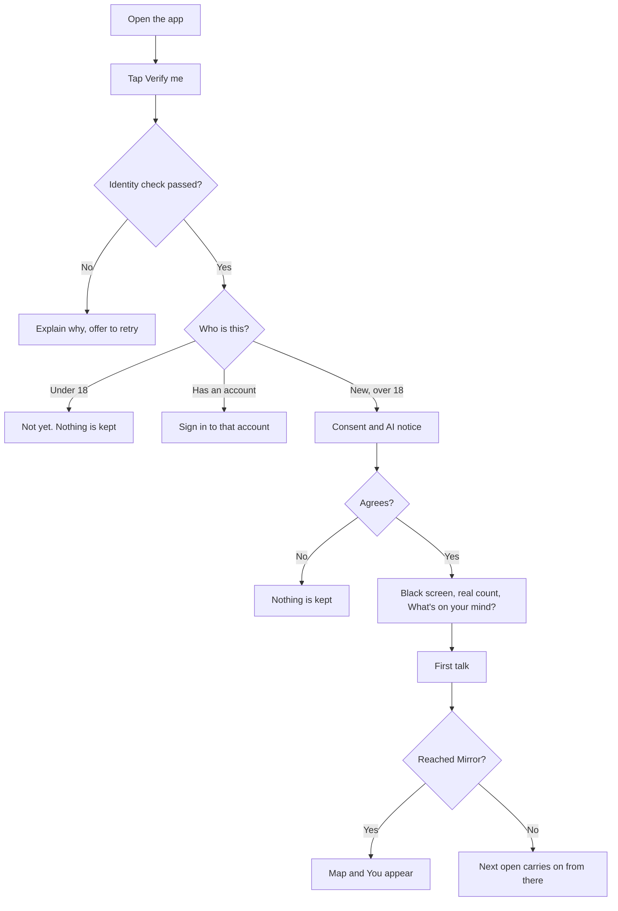

## 2. One turn of a live talk

1. The person talks. Audio goes to the backend, and from there to the speech service. Captions appear as they speak.
2. When they stop, the engine reads the conversation so far and picks the next move.
3. It builds an evidence pack from the database.
4. The model writes the reply against that pack.
5. Code fills in the numbers and checks the reply.
6. The phone shows the caption and plays the voice.
7. The turn is saved, and a background job pulls out any new claims.

With "Type instead", steps 1 and 6 skip speech. The rest is the same.

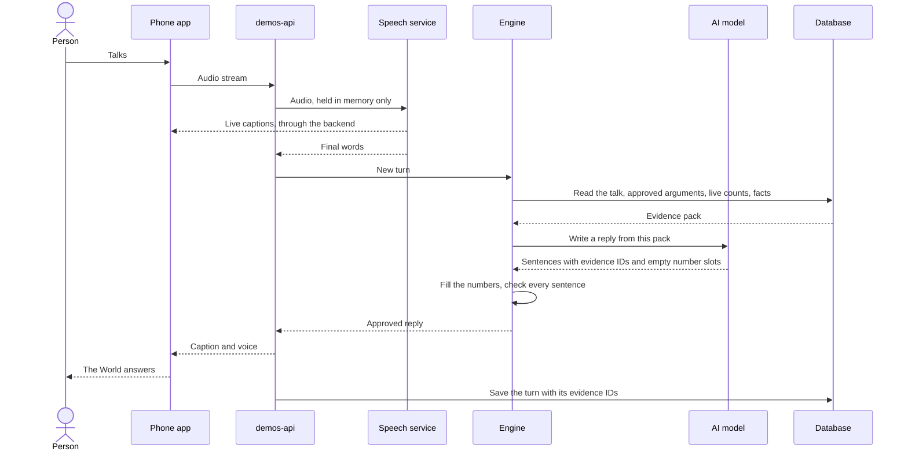

## 3. How the World picks its next move

Code makes this choice. The model doesn't. The five modes are never named in the app.

1. **Listen** until there's at least one clear view on the table.
2. **Mirror** after two or three statements, and always before a Challenge. This is what makes a Challenge fair.
3. **Where you stand:** once confirmed, the World says how others see it ("Most of us in Milan...").
4. **Challenge** if there's an approved opposing argument this person hasn't heard.
5. **Inform** if there's a reviewed fact that bears on what was said, or the person asks.
6. **Bridge** if there's something both sides might accept.
7. If there's nothing left to offer, the World thanks them and ends the talk.

Limits that always apply:

- One Challenge per talk, unless the person asks for more.
- "Not now" or "stop" works at any point.
- A topic with too few people takes [flow 6](#6-not-enough-of-us-yet).
- Signs of distress jump straight to [flow 13](#13-someone-is-in-trouble).

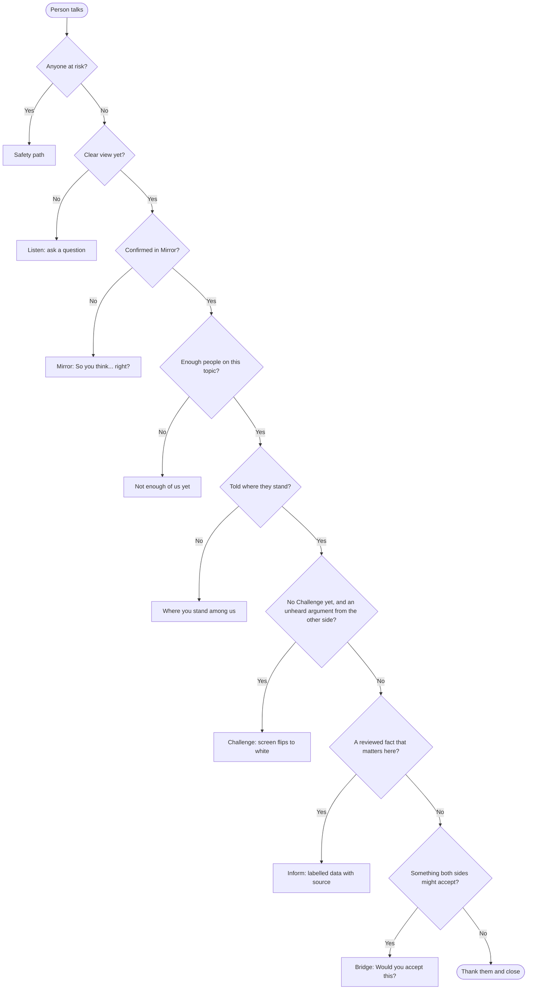

## 4. Checking a reply before it's said

1. The model returns sentences, each tagged with evidence, with empty slots for numbers.
2. Code fills every slot.
3. Code checks the rules: every claim has evidence, every "we" has enough people behind it, no "I think".
4. A second small check asks whether each sentence says more than its evidence says.
5. The content rules run.
6. A reply that passes is said. A reply that fails gets one rewrite. If that fails too, or the model declines or goes down, the World says a plain line such as "We don't know yet."
7. Failures are logged and reviewed. A rising rate of them blocks a release.

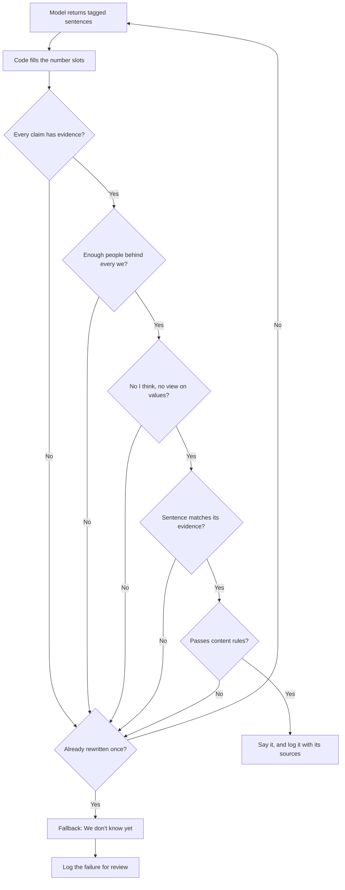

## 5. Mirror: how a position gets counted

There are no vote buttons. This is how the "no voting" idea stays accurate.

1. As someone talks, the worker pulls out what they seem to believe and saves each view as **inferred**.
2. Inferred views stay private and count toward nothing.
3. In Mirror, the World says them back: "So you agree with A, partly with B, and you're unsure about C. Right?"
4. The person says yes, corrects it out loud, or taps a line to fix it.
5. A yes makes the view **confirmed**. A fix makes it **corrected**. Both now count.
6. No answer changes nothing.
7. If they later say something different, the World mirrors again. The old view closes, the new one opens, and the numbers move on their own.

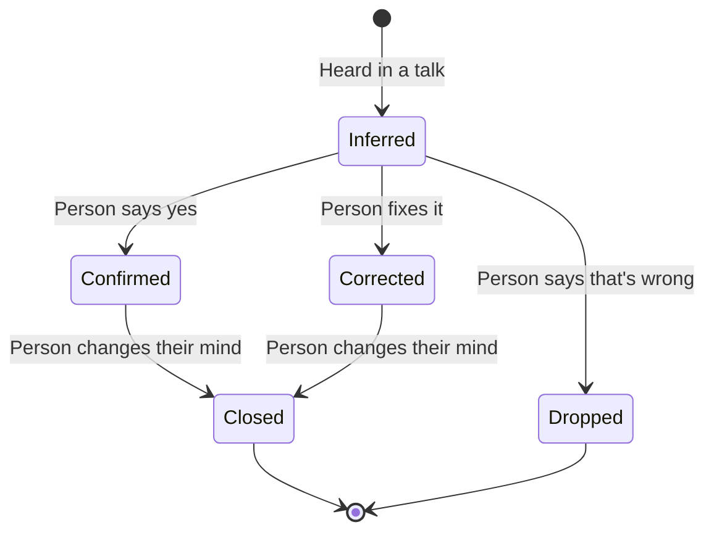

Only Confirmed and Corrected views reach public numbers.

## 6. Not enough of us yet

1. Someone brings up a topic with too few people (fewer than 30).
2. The World says so honestly: "Not many of us have talked about this yet."
3. If there are reviewed facts, it offers them, labelled as data.
4. If there are none, it says "We don't know" and leaves it at that.
5. It invites them to be one of the first.
6. Their words count toward the topic. When enough people arrive, the World can speak as "we".

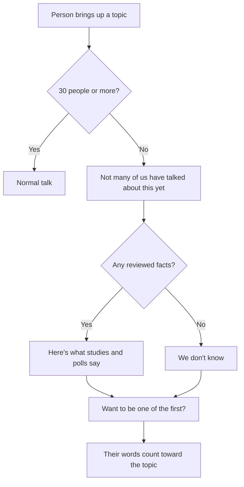

## 7. From talk to numbers

This runs in the background after a talk ends, and overnight for the heavy steps.

1. **Extract:** pull claims and views out of the transcript, and link each to the turn it came from.
2. **Clean:** strip names, places and anything that could identify someone.
3. **Match:** link each claim to an existing topic and statement, or park it for a new topic.
4. **Merge:** group claims that make the same point into one argument, counting different people, never repeated words.
5. **Rewrite:** turn each merged argument into its strongest fair wording, in Italian and English.
6. **Review:** a person approves it before anyone hears it (during the pilot).
7. **Count:** recompute groups, percentages, gaps, topic links and Agreement rules from confirmed views.
8. **Prepare:** work out what the World should say first to each person next time.

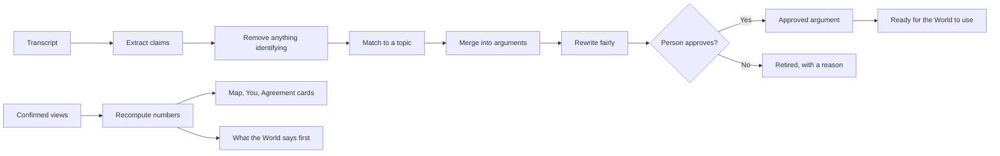

## 8. The World speaks first

On open, the World picks at most one thing to say, and often it says nothing and just waits.

1. Check what's waiting for this person, in this order: close to agreement, it needs you, news for you, daily question.
2. Skip anything already shown, anything they've turned down, and anything from a paused topic.
3. Show the first that's left.
4. If nothing is left, the plain mic screen.
5. Tapping the mic starts a talk on that subject. Ignoring it is fine and costs nothing.

Notifications follow the same order, are opt-in, and go out at most once a day. Their text never mentions a person's view, since it shows on a lock screen and passes through Apple and Google.

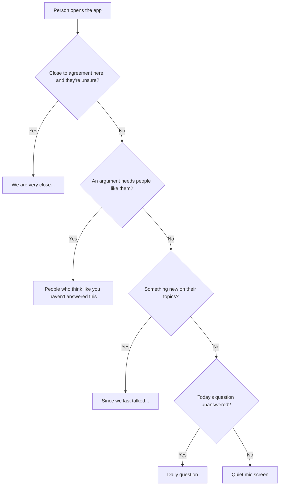

## 9. A new topic appears

Nobody creates a topic by hand. Topics show up when people keep talking about the same thing.

1. Claims that match no topic get parked.
2. The worker looks for clusters of them.
3. When 20 different people raise the same subject within 14 days, it proposes a topic.
4. A person reviews it against the content rules, and checks it isn't an election contest.
5. If approved, it goes live as a forming topic.
6. It appears on the Map once 30 people are in it.

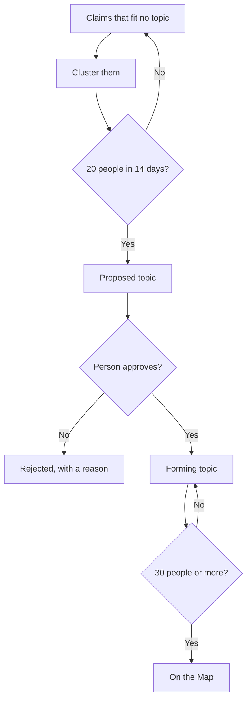

## 10. An Agreement is born and lives

1. An idea reaches the bar: 60% overall, and 55% in at least two groups that usually disagree, with enough people in each.
2. It becomes a **candidate**, and the World starts "Close to agreement" with people who are unsure.
3. If it holds for 14 days, it goes **live**: a card with real numbers, a public web page, and a share button.
4. Numbers keep moving as people change their minds.
5. Anyone who's part of it can ask for it to be sent to the city council.
6. At 100 requests, a person reviews it, adds a note on method and who was asked, and Demos sends it once.
7. If support falls below the bar for 7 days, the card **lapses**. It stays visible and says so.

**"Use as a petition" comes later.** A formal petition needs real names and has to follow the city's rules, so someone would have to choose to give up their anonymity for it.

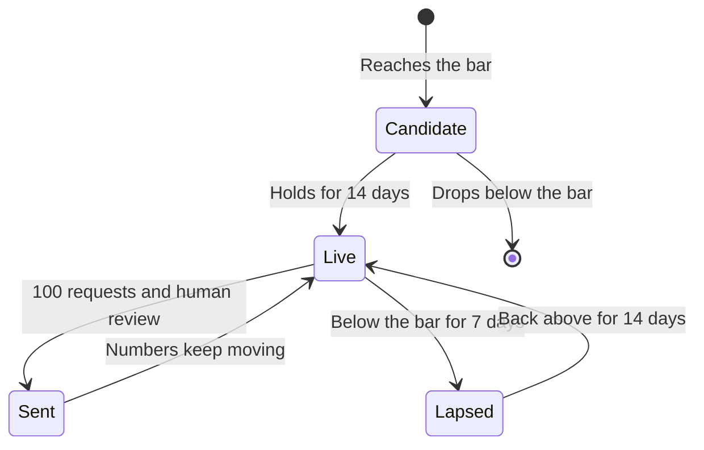

## 11. Your words travel

1. A person says something. It feeds an argument, and the link is saved.
2. The World uses that argument in someone else's talk. An exposure is saved.
3. If the listener's view moves within 7 days and they confirm it, the exposure is marked as changed.
4. Both counts show up on the first person's You screen.
5. If both sides accept a Bridge built from their idea, it counts toward Bridge builder. Convincing your own side counts for nothing.

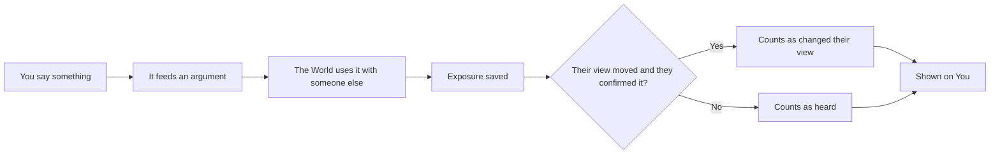

## 12. Reporting a reply

1. Anyone can report any reply in one tap, or by saying so.
2. It goes into the review queue with the exact evidence behind the reply.
3. Anything serious takes that argument out of use straight away, while it's reviewed.
4. A person decides: keep it, change it or remove it.
5. The reporter gets the decision and the reason, and can ask for a second look.
6. Illegal content follows the legal route.
7. Decisions are counted in a transparency report.

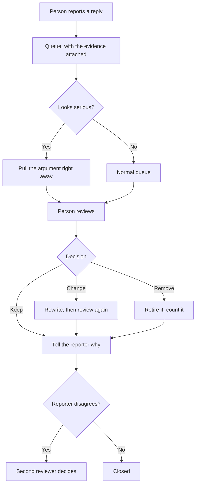

## 13. Someone is in trouble

1. The engine checks every turn for signs that someone may hurt themselves or someone else.
2. If it finds any, the talk stops being a debate. No Challenge, no numbers, no "we".
3. A plain card shows Italian help lines and 112, in the person's language.
4. The person can carry on or stop.
5. That turn is left out of arguments and numbers completely.
6. A safety event is logged without the words, so the rule can be improved.

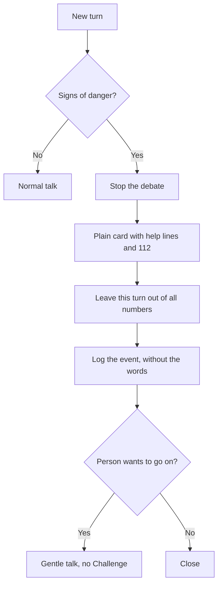

## 14. Delete everything

1. The person picks Delete in Settings and confirms.
2. Their stances, transcripts, group memberships and argument links go.
3. The vault entry goes too, so they could sign up fresh. A banned person's hash stays for the length of the ban.
4. Arguments that fall below five people retire.
5. Numbers recompute. Past dated snapshots stay because they hold no person.
6. Backups age out on a fixed schedule.
7. They get a confirmation.

Withdrawing consent follows the same path. It can also be limited to one purpose, such as voice processing.

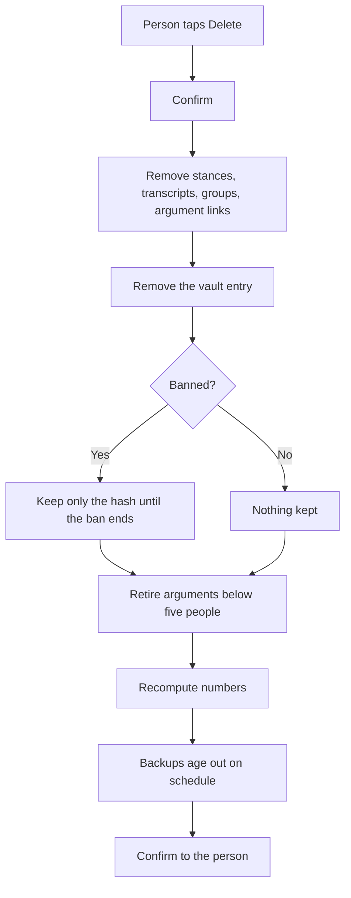

## 15. Election pause

Italian law limits publishing poll results in the 15 days before a vote. Whether Demos numbers count as polls is still an open legal question. Until there's an answer, Demos plays it safe.

1. Someone on the team enters each vote in the calendar: area, date and which topics it touches.
2. From 15 days before until the polls close, those topics pause their public numbers.
3. People can still talk. The World says the numbers are paused and why.
4. Agreement cards on those topics hide their percentages, and nothing gets sent.
5. After the vote, numbers return.

Parties and candidates are off limits at all times, not just during a pause.

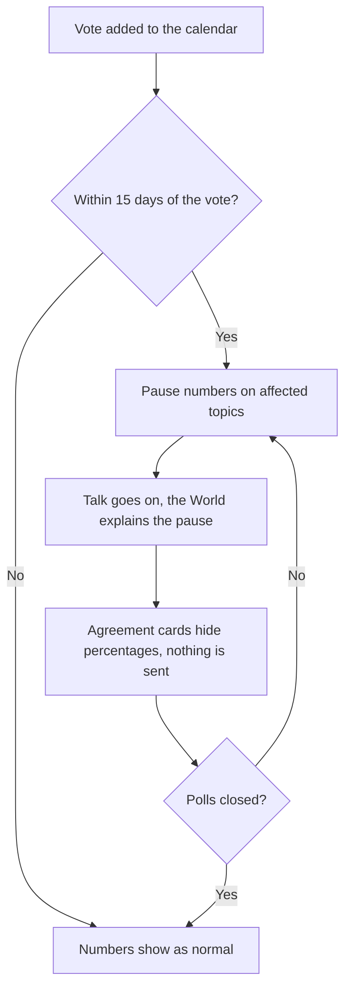
